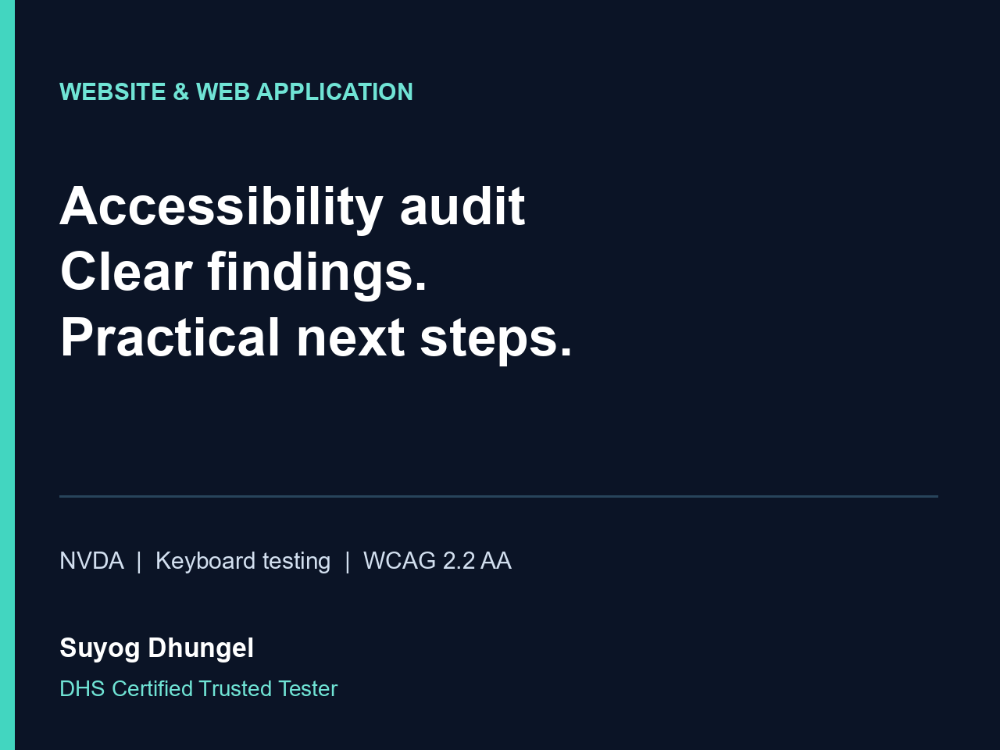

# Suyog Dhungel

**Accessibility Auditor & Web Developer | DHS Certified Trusted Tester**

I help teams build websites and web applications, identify accessibility barriers, and turn findings into practical improvements. My work combines manual screen-reader and keyboard testing, technical inspection, clear reporting and development support.

## Services

- Website and web application accessibility audits against WCAG 2.2 Level AA, with agreed representative pages and complete user journeys.
- Manual NVDA screen-reader and keyboard testing, supported by automated checks.
- Reports with reproduction steps, user impact, WCAG references, priorities and remediation guidance.
- Retesting after fixes and ongoing accessibility QA.
- Web development and WordPress support, with accessibility considered throughout the work.
- Application interface accessibility reviews and development support, with scope and environments agreed before starting.
- Document accessibility reviews, accessible publishing guidance and team training.

## Certification

**DHS Trusted Tester Certification - Trusted Tester for Web on Windows**  
U.S. Department of Homeland Security | Issued 7 October 2026  
Credential ID: **TT-2710-09754**

## Selected development projects

- [NepaliReader](https://github.com/SuyogDhungel/nepaliReader): collaborative work on an NVDA add-on for legacy-font and broken Nepali PDF text. See the repository for contributors, scope and usage.
- [Model Disabled Society Rasuwa website](https://github.com/SuyogDhungel/model-disabled-society-rasuwa): a React-based website project. See the repository for implementation details.

## Audit sample and service overview

- [Anonymized audit report sample (PDF)](Accessibility_Audit_Sample.pdf) — findings, user impact, WCAG references, remediation guidance and retesting checks.
- [54-second service overview video](Accessibility_Service_Overview.mp4) — silent, text-led introduction to my audit process.
- [Video text transcript](Accessibility_Service_Transcript.txt).

## Work with me

Available remotely for accessibility audits, web development, ongoing QA, agency subcontracting and retesting. Share your website or application, key user journeys, testing environments and deadline so we can agree a practical scope.

[Website](https://suyogdhungel.com.np) · [Fiverr](https://www.fiverr.com/suyogdhungel) · [Upwork](https://www.upwork.com/freelancers/~017d0d0277e0d303e3)
